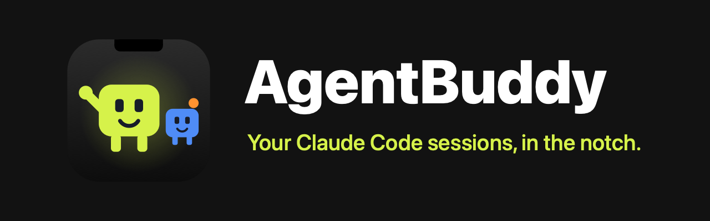
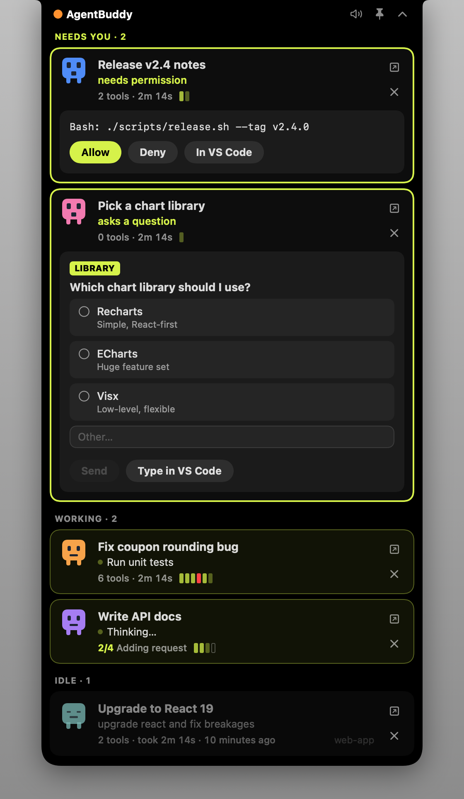
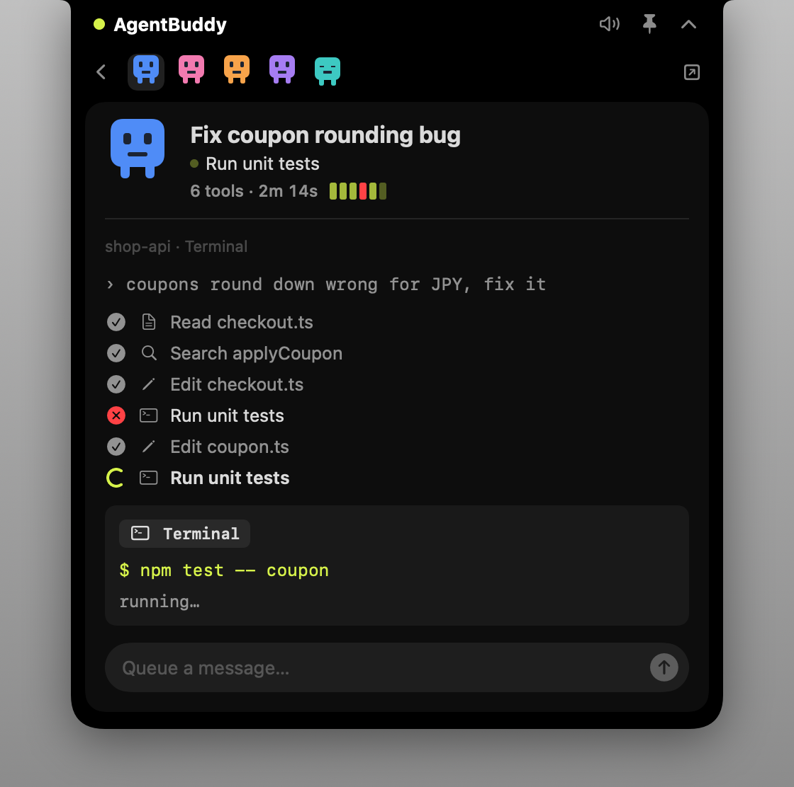

<p align="center"></p>

<p align="center">Every Claude Code session, at a glance, in your Mac's notch.<br>
See who's working, who's done, and who needs you — and answer them without switching windows.</p>

<p align="center"></p>

<p align="center">
&nbsp;
</p>

## What it does

- **Finds every session automatically.** Claude Code in Terminal, iTerm2, tmux or VS Code (and VS Code forks such as Cursor) shows up on its own. No setup per project.
- **Lives in the notch.** Collapsed, it's a small black pill around the notch: your sessions' robots on the left, how many need you on the right. Hover to open it; move away, click elsewhere or press <kbd>Esc</kbd> to close it. On Macs without a notch it hangs under the menu bar.
- **Needs you · Working · Idle.** Sessions that need you come first with a lime ring. Working ones are highlighted with their live activity ("Run unit tests", "Edit coupon.ts"). Idle ones are dimmed.
- **Honest progress.** One tick per tool call (failures in red) and a live timer. A real "3/5" only when the session keeps a todo list.
- **Answer from the notch.** Allow / Deny permission requests and answer Claude's multiple-choice questions right in the island, or hand them back to Claude's own prompt with one click.
- **Send a message.** Type a prompt into a Terminal, iTerm2 or tmux session from the session's detail view. (VS Code has no way to accept outside input, so AgentBuddy copies your text and opens the window for you to paste.)
- **Jump to it.** ⌖ opens the exact Terminal/iTerm tab, or the VS Code window for that folder.
- **Sounds.** A chime when a session needs you, a tick when one finishes. Mute from the island.

Everything stays on your Mac. AgentBuddy makes no network requests.

## Install

Needs macOS 14 (Sonoma) or newer, Apple Silicon or Intel.

**One line (Terminal):**

```sh
curl -fsSL https://raw.githubusercontent.com/mealisohail/agentbuddy/main/install.sh | sh
```

**Homebrew:**

```sh
brew tap mealisohail/agentbuddy https://github.com/mealisohail/agentbuddy
brew install --cask agentbuddy
```

**Manual:** download `AgentBuddy.zip` from [Releases](https://github.com/mealisohail/agentbuddy/releases), unzip, move `AgentBuddy.app` to Applications, then **right-click → Open** the first time.

> **Why the extra step?** AgentBuddy is free and isn't notarized by Apple (that needs a paid developer account), so macOS warns about apps downloaded through a browser. The one-line and Homebrew installers take care of this for you. If macOS still says the app "can't be opened", run
> `xattr -dr com.apple.quarantine ~/Applications/AgentBuddy.app` (or `/Applications/…`) and open it again.

## Turn on Allow / Deny from the notch

Watching sessions works out of the box. To answer permission requests and questions from AgentBuddy, click **Enable** in the island (or right-click the menu-bar robot → *Answer Permissions in AgentBuddy*). This adds one `PermissionRequest` hook to `~/.claude/settings.json`. Everything else in that file is kept, and a backup is saved next to it as `settings.json.agentbuddy-backup`. Restart running Claude Code sessions to pick it up.

How it behaves:

- While a request is waiting in AgentBuddy, Claude Code waits for your answer. Click **In Terminal / In VS Code** to answer with Claude Code's own prompt instead, for example to choose "always allow".
- If you answer in VS Code or the terminal instead, the card disappears by itself.
- If AgentBuddy isn't running, or has been deleted, the hook does nothing and Claude Code prompts as usual.
- Turn it off any time: menu-bar robot → *Remove Claude Code Hook*.

The first time you click ⌖ or send a message to a Terminal/iTerm session, macOS asks whether AgentBuddy may control that app. Allow it to select the right tab; if you don't, AgentBuddy just brings the app forward.

## Uninstall

```sh
~/Applications/AgentBuddy.app/Contents/MacOS/AgentBuddy --uninstall-hook   # take the hook out of ~/.claude/settings.json
rm -rf ~/Applications/AgentBuddy.app ~/.agentbuddy
```

With Homebrew: `brew uninstall --cask agentbuddy` (removes the hook for you; add `--zap` to also delete preferences).

## How it works

| What you see | Where it comes from |
|---|---|
| Live sessions and their state (working / idle / waiting for you) | `~/.claude/sessions/<pid>.json`, which Claude Code keeps for every running session |
| Title, prompt, steps, last command | the session transcript, `~/.claude/projects/<folder>/<session>.jsonl`, read incrementally |
| Allow / Deny / answers | a `PermissionRequest` hook that runs `AgentBuddy --hook`, which talks to the app over a private socket in `~/.agentbuddy` |

## Limitations

- **Unofficial.** AgentBuddy is not made by or affiliated with Anthropic. It reads Claude Code's local files, whose format isn't documented, so a Claude Code update can break parts of it until AgentBuddy is updated.
- **VS Code input.** Claude Code's VS Code panel doesn't accept outside input, so *send message* copies instead of typing there.
- **Very long sessions.** On first launch only the newest 8 MB of each transcript is read, so the prompt or elapsed time of a very long turn may be missing until the next prompt.
- **Not notarized** (see Install).

## Build from source

Needs Xcode 15 or newer.

```sh
./build.sh             # build, install to ~/Applications and launch
./build.sh --release   # universal build → dist/AgentBuddy.zip, updates Casks/agentbuddy.rb
swift run AgentBuddy --selftest
tests/e2e.sh           # end-to-end against a real Claude Code session in tmux (uses a few cheap model calls)
swift scripts/make-icon.swift   # regenerate the icon
```

### Publishing a release

1. Bump `VERSION` in `build.sh`, then run `./build.sh --release`.
2. Create a GitHub release tagged `v<version>` and upload `dist/AgentBuddy.zip`.
3. Commit the updated `Casks/agentbuddy.rb`.

## License

[MIT](LICENSE) © 2026 Sohail Akhtar Ali
